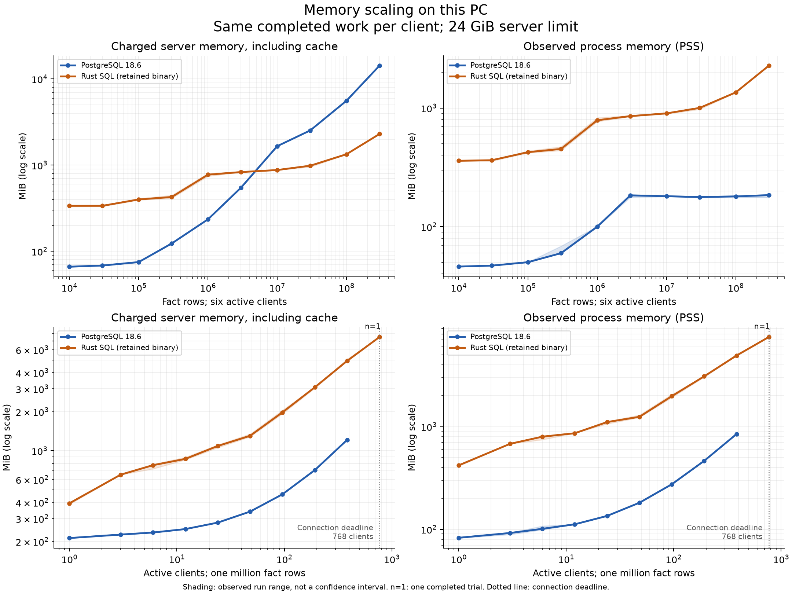

# Memory scaling experiment

Local experiment using the retained Rust SQL binary and PostgreSQL 18.6. This report is descriptive, not a production qualification.

Each point runs 6 warmup and 12 measured mixed-workload bundles per client. A bundle has 12 point reads, 4 committed updates, and 3 analytical queries. Facts use PostgreSQL heap storage or Rust columnar storage; accounts remain 120,000 rows. Loading uses batches of at most one million rows. Results, protocol type IDs, committed balances and restart persistence are checked.

The server gets 24 GiB and 12 logical CPUs spanning six cores in the WSL topology; clients use two other cores. The PC has 64 GiB installed RAM and WSL currently exposes about 30 GiB. Swap is disabled for both test groups. PostgreSQL shared_buffers stays at 128 MiB; work_mem is 16 MiB for both engines. Active-query admission follows the tested client count, so this explores active concurrency, including overload.

Charged memory includes filesystem cache. PSS apportions shared mappings and is not summed RSS. The main query-window peaks combine periodic samples with synchronized readings after warmup and after completed work while connections remain open. The exact cgroup lifetime peak, including setup and restart, is retained separately.

## Conclusions

The large-data CPU advantage persists: at 300 million rows, Rust uses 93.0% less server CPU per completed bundle and delivers 16.2 times PostgreSQL throughput. At 10,000 rows it uses 29.6% more CPU. The savings belong to this analytical-heavy resource mix, not to every SQL workload.

Charged-memory ranges cross between 3 million and 10 million rows in all three repeats. Rust process PSS remains higher at every tested size. PostgreSQL uses substantially more filesystem cache; that cache is reclaimable, so the charged-memory crossover does not close the process-memory gap.

Over 3 million to 300 million rows, Rust PSS is well described by a fixed intercept of 857 MiB plus 4.99 bytes per row (fit RMSE 13.0 MiB). PostgreSQL PSS is nearly flat in this range, around 180 MiB with fixed buffers. These are empirical fits within the measured configuration, not Big-O proofs or extrapolations past memory pressure.

Concurrency adds memory much faster than useful throughput. At one million rows, 24 active clients deliver 94.1% of Rust's best repeated median throughput. At 384 clients, Rust uses 4929 MiB charged memory versus PostgreSQL's 1214 MiB. This suggests testing admission and per-session overhead before allowing hundreds of simultaneously active queries; it is not a universal connection-pool recommendation.

The 768-client boundary is a PostgreSQL three-second connection timeout during synchronized startup, with no server or driver memory-limit/OOM event. Rust completes that one trial, but throughput declines. It does not establish PostgreSQL's maximum sustainable connections or a RAM limit.

Restarting and rerunning the workload does not remove most Rust process memory. Shared decoded-data counters reset at restart and grow again when the aggregate runs. At 300 million rows this class reaches about 866 MiB despite a 256 MiB decoded-cache cap; cached and held remain zero. The source explicitly excludes this shared (sticky) class from that cap. The counters explain part of the row-dependent growth, not all process memory.

Memory optimization is still justified: profile fixed/session overhead first, then evaluate bounded decoded-data retention with CPU and latency guards. Lowering the existing cache-size setting alone does not bound the shared class. No runtime/default is promoted by this experiment, and the original fixed-rate medium-load memory/read/update targets remain open.

The main size and concurrency campaigns retain 115 successful trials and 1 failed trial; all 9 restart controls pass. The archive also retains the pilot and the rejected small-integer generate_series harness, which failed on both engines before explicit integer casts were added.

## Timing validity

The concurrency campaign is not eligible for performance qualification. Its raw CPU/throughput/latency values remain descriptive, and the affected table row is marked with a dagger. Memory observations remain in the memory fits. No dataset-size trial has timed server or driver throttling.

- connections, 384, Rust SQL (retained binary), repeat 2: server throttled 20.944 ms; driver throttled 0.000 ms.

## Rows at six clients

| Size | Engine | Runs | Charged MiB | PSS MiB | CPU ms/bundle | Bundles/s | Read p99 ms | Update p99 ms |
|---:|---|---:|---:|---:|---:|---:|---:|---:|
| 10,000 | PostgreSQL 18.6 | 3 | 66.211 | 46.171 | 3.240 | 527.553 | 0.850 | 1.749 |
| 10,000 | Rust SQL (retained binary) | 3 | 337.137 | 359.586 | 4.199 | 515.118 | 0.908 | 2.051 |
| 30,000 | PostgreSQL 18.6 | 3 | 68.348 | 47.016 | 6.824 | 401.947 | 0.815 | 1.852 |
| 30,000 | Rust SQL (retained binary) | 3 | 337.266 | 363.368 | 4.559 | 498.849 | 0.953 | 1.953 |
| 100,000 | PostgreSQL 18.6 | 3 | 74.945 | 50.284 | 19.970 | 209.241 | 0.496 | 1.532 |
| 100,000 | Rust SQL (retained binary) | 3 | 399.613 | 424.873 | 6.288 | 459.112 | 0.987 | 2.021 |
| 300,000 | PostgreSQL 18.6 | 3 | 123.324 | 59.887 | 80.553 | 113.997 | 0.473 | 1.658 |
| 300,000 | Rust SQL (retained binary) | 3 | 426.664 | 452.389 | 9.094 | 410.933 | 0.969 | 1.885 |
| 1,000,000 | PostgreSQL 18.6 | 3 | 234.773 | 100.191 | 266.596 | 37.675 | 0.836 | 7.160 |
| 1,000,000 | Rust SQL (retained binary) | 3 | 775.109 | 789.544 | 21.680 | 284.695 | 0.981 | 1.719 |
| 3,000,000 | PostgreSQL 18.6 | 3 | 547.680 | 183.749 | 792.749 | 12.173 | 0.593 | 7.324 |
| 3,000,000 | Rust SQL (retained binary) | 3 | 831.086 | 855.124 | 55.455 | 150.444 | 0.568 | 2.050 |
| 10,000,000 | PostgreSQL 18.6 | 3 | 1,659.980 | 180.799 | 2,630.271 | 3.592 | 0.586 | 15.002 |
| 10,000,000 | Rust SQL (retained binary) | 3 | 877.238 | 901.833 | 193.803 | 51.424 | 0.540 | 1.758 |
| 30,000,000 | PostgreSQL 18.6 | 3 | 2,529.660 | 177.735 | 8,181.847 | 1.176 | 0.691 | 6.730 |
| 30,000,000 | Rust SQL (retained binary) | 3 | 984.984 | 1,002.704 | 552.265 | 19.260 | 0.495 | 1.986 |
| 100,000,000 | PostgreSQL 18.6 | 3 | 5,590.691 | 180.221 | 26,517.516 | 0.364 | 0.595 | 6.664 |
| 100,000,000 | Rust SQL (retained binary) | 3 | 1,338.562 | 1,355.313 | 1,893.969 | 5.753 | 0.573 | 2.172 |
| 300,000,000 | PostgreSQL 18.6 | 3 | 14,289.906 | 184.557 | 79,982.618 | 0.121 | 0.573 | 6.397 |
| 300,000,000 | Rust SQL (retained binary) | 3 | 2,299.609 | 2,276.501 | 5,616.476 | 1.956 | 0.541 | 2.302 |

## Clients at one million rows

| Size | Engine | Runs | Charged MiB | PSS MiB | CPU ms/bundle | Bundles/s | Read p99 ms | Update p99 ms |
|---:|---|---:|---:|---:|---:|---:|---:|---:|
| 1 | PostgreSQL 18.6 | 3 | 212.625 | 82.772 | 197.315 | 12.658 | 0.266 | 1.158 |
| 1 | Rust SQL (retained binary) | 3 | 393.969 | 420.010 | 20.772 | 54.711 | 0.406 | 0.989 |
| 3 | PostgreSQL 18.6 | 3 | 226.156 | 92.154 | 243.082 | 30.911 | 0.313 | 1.487 |
| 3 | Rust SQL (retained binary) | 3 | 654.172 | 679.789 | 20.191 | 162.175 | 0.397 | 1.347 |
| 6 | PostgreSQL 18.6 | 3 | 234.492 | 101.182 | 279.114 | 35.731 | 0.756 | 6.470 |
| 6 | Rust SQL (retained binary) | 3 | 774.379 | 798.512 | 21.476 | 286.496 | 0.905 | 1.906 |
| 12 | PostgreSQL 18.6 | 3 | 249.312 | 111.959 | 281.448 | 38.304 | 6.309 | 8.801 |
| 12 | Rust SQL (retained binary) | 3 | 865.754 | 862.354 | 22.209 | 377.904 | 3.175 | 6.644 |
| 24 | PostgreSQL 18.6 | 3 | 279.570 | 135.100 | 281.041 | 39.110 | 8.283 | 12.145 |
| 24 | Rust SQL (retained binary) | 3 | 1,089.074 | 1,107.918 | 23.065 | 417.056 | 5.452 | 8.260 |
| 48 | PostgreSQL 18.6 | 3 | 340.000 | 181.579 | 278.325 | 39.537 | 14.380 | 18.759 |
| 48 | Rust SQL (retained binary) | 3 | 1,304.117 | 1,245.858 | 24.215 | 429.018 | 7.449 | 8.792 |
| 96 | PostgreSQL 18.6 | 3 | 462.152 | 274.616 | 279.325 | 39.405 | 28.367 | 26.883 |
| 96 | Rust SQL (retained binary) | 3 | 1,977.309 | 1,979.416 | 24.658 | 440.805 | 5.744 | 7.940 |
| 192 | PostgreSQL 18.6 | 3 | 709.691 | 464.013 | 279.477 | 39.568 | 56.566 | 27.980 |
| 192 | Rust SQL (retained binary) | 3 | 3,083.328 | 3,086.749 | 24.661 | 443.412 | 7.529 | 9.385 |
| 384 | PostgreSQL 18.6 | 3 | 1,213.672 | 846.032 | 270.187 | 40.972 | 112.804 | 43.986 |
| 384 | Rust SQL (retained binary) † | 3 | 4,928.621 | 4,918.061 | 25.203 | 434.537 | 12.502 | 19.058 |
| 768 | Rust SQL (retained binary) | 1 | 7,522.680 | 7,459.537 | 35.233 | 307.791 | 23.853 | 30.550 |

## Large-row linear fits

These nonnegative intercept-and-slope fits use completed, uncapped points with at least three repeats and at least three million rows. The slopes describe this observed range, not an asymptotic proof.

| Engine | Metric | Row range | Intercept MiB | Bytes per additional row | RMSE MiB |
|---|---|---|---:|---:|---:|
| PostgreSQL 18.6 | charged_mib | 3,000,000–300,000,000 | 965.473 | 46.844 | 299.000 |
| PostgreSQL 18.6 | pss_mib | 3,000,000–300,000,000 | 180.387 | 0.012 | 2.116 |
| PostgreSQL 18.6 | whole_lifetime_charged_mib | 3,000,000–300,000,000 | 973.560 | 46.965 | 301.150 |
| Rust SQL (retained binary) | charged_mib | 3,000,000–300,000,000 | 830.772 | 5.154 | 10.570 |
| Rust SQL (retained binary) | pss_mib | 3,000,000–300,000,000 | 856.720 | 4.989 | 13.008 |
| Rust SQL (retained binary) | whole_lifetime_charged_mib | 3,000,000–300,000,000 | 855.470 | 5.081 | 15.763 |

## Rust restart control

The same stored facts are queried with six clients after restarting the process. Account balances are reset so the workload has the same oracle. This distinguishes memory retained across loading from memory reconstructed by subsequent queries.

| Rows | Run | Before restart PSS MiB | After restart PSS MiB |
|---:|---:|---:|---:|
| 1,000,000 | 1 | 767.439 | 785.306 |
| 100,000,000 | 1 | 1,344.951 | 1,320.755 |
| 300,000,000 | 1 | 2,266.068 | 2,244.748 |
| 300,000,000 | 2 | 2,280.601 | 2,252.755 |
| 100,000,000 | 2 | 1,346.752 | 1,315.265 |
| 1,000,000 | 2 | 776.452 | 752.878 |
| 1,000,000 | 3 | 767.271 | 786.986 |
| 100,000,000 | 3 | 1,344.888 | 1,323.948 |
| 300,000,000 | 3 | 2,277.032 | 2,246.773 |

The shared decoded-data class is reported separately from the cap. The following medians include only available diagnostic counters; no unavailable value is replaced with zero.

| Rows | Runs | PSS before restart MiB | PSS after restart/work MiB | Shared decoded data after work MiB | Cache cap MiB |
|---:|---:|---:|---:|---:|---:|
| 1,000,000 | 3 | 767.439 | 785.306 | 3.335 | 256.000 |
| 100,000,000 | 3 | 1,344.951 | 1,320.755 | 289.089 | 256.000 |
| 300,000,000 | 3 | 2,277.032 | 2,246.773 | 866.370 | 256.000 |

## Observed failures

- connections, value 768, PostgreSQL 18.6: connection_timeout. Raw error: AssertionError({'phase': 'warmup', 'received': 1, 'client': {'client': 390, 'passed': False, 'error': "ConnectionTimeout('connection timeout expired')"}})

## Interpretation limits

- Finite measurements cannot prove an asymptotic complexity class.
- Fixed buffers, retained allocator pages, filesystem cache and per-session allocations are different contributors.
- Filesystem cache can be reclaimed under pressure. A linear fit of unconstrained charged memory is not proof of unavoidable engine allocation growth or of behavior at a tighter memory limit.
- Three-run min/max ranges are observed variation, not confidence intervals.
- PSS is sampled plus synchronized connected endpoints; transient peaks can still be missed.
- CPU and latency are diagnostic; short unpaced runs and a different CPU/memory envelope do not qualify an optimization.
- The schema is synthetic, narrow and highly compressible; compression and query working sets determine crossover locations.
- Connections start in a synchronized burst with a three-second connect timeout. A connection timeout is not evidence of a RAM limit or a maximum sustainable connection count.
- The driver cgroup is reused within a campaign: its memory.peak is a campaign running peak, not a per-trial peak.
- At six clients, each trial measures 864 reads, 288 updates and 72 instances of each analytical query; analytical p99 is therefore the observed maximum under the nearest-rank convention.
- The statement mix is 12 reads, 4 updates and 3 analytical queries per bundle. At large row counts, analytical work dominates CPU; these savings do not establish pure-OLTP performance.

The JSON contains per-trial results, observed ranges, constant/log/linear/power fits with leave-one-point-out prediction error, resource breakdowns, throttling, and failures. Model fit is an empirical description only. Fits require at least three successful repeats without memory-limit events. Failures remain in the records; successful boundary runs remain in the plots.
